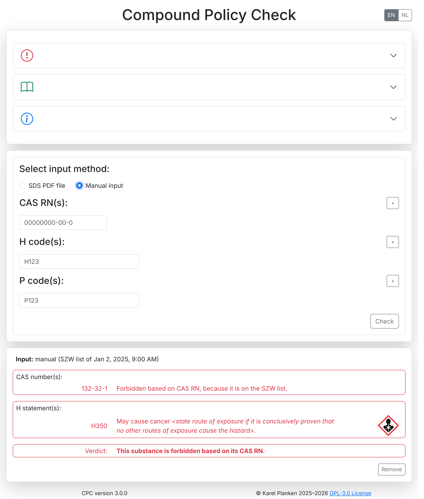
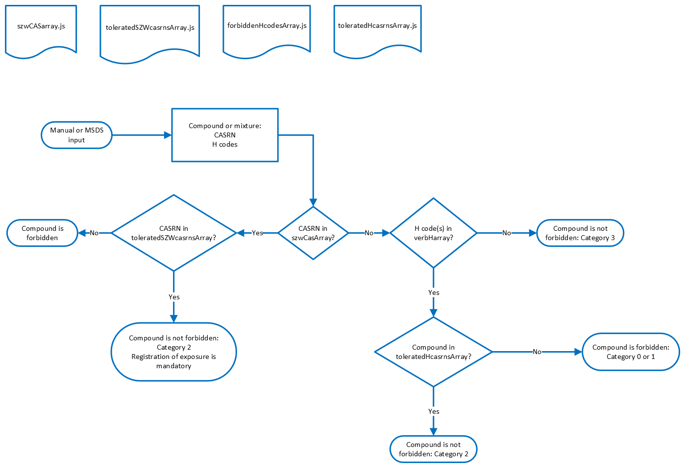

# Compound Policy Check App (cpc app)


## <a id='toc'>Table of Contents</a>

- [Problem Statement](#problem-statement)
- [Why This Project?](#why-this-project)
- [Project Overview](#project-overview)
  - [Functionality](#functionality)
  - [Features](#features)
  - [Boundary Conditions](#boundary-conditions)
  - [The User Interface](#ui)
- [How It Works](#how-it-works)
  - [Directory Structure](#directory-structure)
  - [Architecture](#architecture)
  - [Decision Tree](#decision-tree)
  - [Application Workflow](#application-workflow)
  - [Languages](#languages)
- [Maintenance](#maintenance)
  - [Updating the Lists](#updating-the-lists)
  - [Updating the Libraries](#updating-the-libraries)
  - [Adding a Language](#adding-a-language)
- [Development](#development)
  - [Testing](#testing)
  - [Deployment](#deployment)
- [Changes in Version 3](#changes-in-version-3)
- [Resources](#resources)
- [License](#license)

## <a id='problem-statement'>Problem Statement</a> [&uarr;](#toc)

Chemical substances—whether pure compounds or mixtures—are subject to strict regulations to prevent environmental harm and protect human health. In the European Union (EU), two key regulatory frameworks govern these substances:

- **REACH** (Registration, Evaluation, Authorisation and Restriction of Chemicals), which applies to all chemical substances.
- **CLP** (Classification, Labelling and Packaging), which aligns EU classification and labelling with the UN’s **Globally Harmonized System (GHS)**.

The **European Chemicals Agency (ECHA)** oversees the implementation of these regulations. A critical component of CLP is the **Harmonized Classification and Labelling (CLH)** system, which ensures consistent risk management for substances of high concern—such as carcinogenic, mutagenic, and reprotoxic chemicals (CMR). Manufacturers, importers, and downstream users are required to adhere to CLH classifications.

If applicable, a chemical is assigned:

- A **GHS hazard pictogram** for visual hazard recognition.
- One or more **H (Hazard)** and **P (Precautionary)** statements, which describe the nature of the hazard and recommended safety measures.

These statements follow a standardized format:

- **HXXX** codes for hazards (e.g., H2XX for physical hazards, H3XX for health, H4XX for environmental).
- **PXXX** codes for precautions (e.g., P1XX for general, P2XX for prevention, P3XX for reaction, P4XX for storage, and P5XX for disposal).

Because scientific understanding evolves, these classifications for chemical compounds are regularly updated. In the Netherlands, the _Ministerie van Sociale Zaken en Werkgelegenheid (SZW)_ publishes a biannual list of CMR substances—currently around 900 entries—identified by name and **CAS Registry Number (CAS RN)**, a unique identifier for chemical substances.

---

In the laboratory where I work, this regulatory information is used to **restrict or exclude** certain chemicals. The lab manages:

- ~1,000 chemical containers
- 500+ active users
- A custom categorization system based on H statements and CAS RNs:

| Category | Description           |
| -------- | --------------------- |
| Cat. 0   | Not allowed           |
| Cat. 1   | Temporarily allowed   |
| Cat. 2   | Allowed but hazardous |
| Cat. 3   | No acute hazards      |

When a chemical is used or ordered, its H statements and CAS RN must be checked against internal lists to determine its category. This manual lookup process is **time-consuming and error-prone**.

---

### <a id='why-this-project'>Why This Project?</a> [&uarr;](#toc)

This project automates the classification process—freeing up time for actual research and reducing the risk of human error. Computers excel at repetitive, rule-based tasks, making them ideal for this kind of regulatory compliance work.

---

## <a id='project-overview'>Project Overview</a> [&uarr;](#toc)

### <a id='functionality'>Functionality</a> [&uarr;](#toc)

The user can input a Safety Data Sheet (SDS) PDF containing the H statements and CAS RNs or can manually enter H codes and CAS RNs. The PDF is processed in the browser, and all H codes, P codes and CAS RNs are extracted. The identifiers from either the SDS or manual input are checked for validity, then looked up in the lists of forbidden H codes and CAS RNs. After processing, the user receives a report. For each entry, a verdict is given and the report concludes whether the substance is 'forbidden' or 'not forbidden'. Note that the latter is not the same as 'allowed', since a chemical substance that does not meet the criteria to be forbidden can still be banned from the lab, e.g. drug precursors.

### <a id='features'>Features</a> [&uarr;](#toc)

- Manual input and file upload
- Bilingual: English (default) and Dutch, switchable at any time
- Runs entirely in the browser: no data leaves the user's computer
- Verification and validation of user input (valid H and P codes, CAS RN check digits, and correct file format)
- Lists (SZW CMR list, tolerated substances, forbidden H codes, H/P statements) are plain JSON files that are easy to update by hand or by a script
- Printable reports

### <a id='boundary-conditions'>Boundary Conditions</a> [&uarr;](#toc)

For historical reasons, the program runs on the client side only, as the institution's portal back-end was not accessible and could not be modified. The app is served as a static site from the `docs/` directory of this repository via GitHub Pages. There is **no build step**: the browser loads the files in `docs/` exactly as they are in the repository (native ES modules, JSON data files and vendored libraries).

### <a id='ui'>The User Interface</a> [&uarr;](#toc)

<figure>
    
    <figcaption>
        Screenshot of the app. The three panels marked with an exclamation mark, a book and an information symbol expand to show instructions and the legend. Below them the input method is chosen: an SDS PDF file or manual input of CAS RNs, H codes and P codes. Reports are stacked at the bottom. The language is switched in the top right corner.
    </figcaption>
</figure>

## <a id='how-it-works'>How It Works</a> [&uarr;](#toc)

### <a id='directory-structure'>Directory Structure</a> [&uarr;](#toc)

<pre>
├── docs/                        The site, served as is by GitHub Pages
│   ├── index.html               Static structure of the page
│   ├── css/styles.css           Custom styles on top of Bootstrap
│   ├── assets/                  Favicon and GHS pictograms (GHS01.svg … GHS09.svg)
│   ├── data/                    The lists and statement catalogs (JSON) and their schemas
│   ├── locales/                 User interface texts: en.json, nl.json
│   ├── vendor/                  Bootstrap and PDF.js, copied from node_modules
│   └── js/
│       ├── main.js              Entry point: creates and connects all parts
│       ├── config.js            Version, locales, locations of resources
│       ├── domain/              Business rules, free of DOM and I/O
│       │   ├── casrn.js             CAS RN format and check digit
│       │   ├── statement-codes.js   H and P code format, ordering
│       │   ├── extraction.js        Finds identifiers in SDS text
│       │   └── policy.js            Classification and verdict
│       ├── data/                Loading of and access to the JSON data
│       ├── i18n/                Translations, locale choice, translating markup
│       ├── pdf/                 Adapter around PDF.js
│       ├── services/            Use cases: assess manual input, assess an SDS file
│       ├── state/               Store of the reports on screen
│       └── ui/                  Forms, report view, language switcher, tooltips
├── scripts/                     Development tooling (static server, vendoring, data validation)
├── tests/                       Unit, integration and end-to-end tests with fixtures
├── decision_tree/               Decision tree of the policy
└── .github/workflows/ci.yml     Continuous integration
</pre>

### <a id='architecture'>Architecture</a> [&uarr;](#toc)

The code is layered; dependencies only point downwards.

| Layer          | Directory                      | Responsibility                                                                               |
| -------------- | ------------------------------ | -------------------------------------------------------------------------------------------- |
| User interface | `js/ui`, `index.html`          | Showing things and reacting to the user. No business rules.                                  |
| Application    | `js/services`, `js/state`      | Use cases (`AssessmentService`) and the reports on screen (`ReportStore`).                   |
| Domain         | `js/domain`                    | The compound policy as pure functions and a `PolicyEngine`. No DOM, no network, no language. |
| Infrastructure | `js/data`, `js/pdf`, `js/i18n` | JSON loading, PDF.js, translations.                                                          |

Design patterns and principles that were applied:

- **Composition root with dependency injection** — `main.js` is the only place where concrete objects are created and connected. Every other module receives what it needs, which is what makes the integration tests possible without a browser or PDF.js.
- **Repository** — `ReferenceData` is the single access point to the lists and catalogs; nothing else knows the file format.
- **Ordered rules (chain of responsibility)** — a CAS RN is classified by the first matching rule in `CASRN_RULES` in `policy.js`. Changing the policy means changing that table.
- **Adapter** — `PdfTextExtractor` and `Tooltips` hide PDF.js and Bootstrap behind small interfaces, so library upgrades touch one file each.
- **Observer** — `ReportStore` and `I18n` notify subscribers; the views re-render when reports or the language change.
- **Language-neutral results** — the policy returns codes (`status`, `basis`, `subject`), never text. The view translates them, so existing reports follow a language switch.
- **Safe rendering** — the DOM is built with `textContent`, never by concatenating HTML, and a Content Security Policy restricts the page to its own files.

### <a id='decision-tree'>Decision Tree</a> [&uarr;](#toc)

<figure>
    
    <figcaption>Decision tree showing the business logic of the Compound Policy Check app. The upper row represents the lists that are used to look up values.</figcaption>
</figure>

In words:

1. Every CAS RN is classified: on the SZW list but tolerated (category 2, exposure must be registered), on the SZW list (category 0), tolerated despite a forbidden H code (category 2), or not listed (category 3).
2. Every H code is forbidden if it, or one of the codes it combines, is on the list of forbidden H codes.
3. The verdict: a forbidden CAS RN forbids the substance or mixture. Otherwise a tolerated CAS RN overrules forbidden H codes. Otherwise a forbidden H code forbids it.

### <a id='application-workflow'>Application Workflow</a> [&uarr;](#toc)

1. `main.js` determines the language, loads `locales/*.json` and `data/*.json` in parallel and starts the user interface (`ui/app.js`).
2. **File input** — `FileForm` hands the file to `AssessmentService.assessSdsFile()`. `PdfTextExtractor` loads PDF.js on first use and returns the text; `extractIdentifiers()` finds all valid CAS RNs and known H and P codes.
   **Manual input** — `ManualForm` validates the fields and hands the identifiers to `AssessmentService.assessManualInput()`.
3. `PolicyEngine.assess()` returns an assessment:

```javascript
{
  casrns: [{ casrn: '7240-90-6', status: 'notListed', category: 3, allowed: true }],
  hCodes: [{ code: 'H302', allowed: true }, { code: 'H312', allowed: true }],
  pCodes: ['P261', 'P264', 'P301+P312'],
  verdict: { allowed: true, basis: null, subject: 'substance' }
}
```

4. The service wraps it in a report (with the input source and the version of the SZW list) and the user interface adds it to the `ReportStore`.
5. `ReportListView` renders all reports with `renderReport()`, looking up statement texts and pictograms in `ReferenceData` and translating with `I18n`.

### <a id='languages'>Languages</a> [&uarr;](#toc)

English (US) is the default. The language is chosen, in order of precedence, by the `lang` query parameter (e.g. `https://compoundpolicycheck.nl/?lang=nl`, handy for links), the choice made on an earlier visit, and the default. Static texts carry `data-i18n` attributes in `index.html` and are filled in from `docs/locales/<locale>.json`; statement texts in `docs/data` carry every language per statement.

## <a id='maintenance'>Maintenance</a> [&uarr;](#toc)

### <a id='updating-the-lists'>Updating the Lists</a> [&uarr;](#toc)

All lists live in [`docs/data`](docs/data) as JSON; their format, rules and a recommended flow for a provisioning script (such as the planned Python CLI) are described in [`docs/data/README.md`](docs/data/README.md). In short, for a new SZW publication:

1. replace the `casrns` in `docs/data/szw-cmr-list.json` and set `meta.publishedAt`;
2. run `npm run validate:data`;
3. commit and push to `main`.

### <a id='updating-the-libraries'>Updating the Libraries</a> [&uarr;](#toc)

Bootstrap and PDF.js are ordinary npm dependencies whose browser builds are copied into `docs/vendor`:

```bash
npm install bootstrap@latest pdfjs-dist@latest
npm run vendor
npm run check
```

A test fails when `docs/vendor` does not match the installed versions.

### <a id='adding-a-language'>Adding a Language</a> [&uarr;](#toc)

1. Copy `docs/locales/en.json` to `docs/locales/<locale>.json` and translate it.
2. Add the locale to `SUPPORTED_LOCALES` and `LANGUAGE_TAGS` in `docs/js/config.js` and add a button to the language switcher in `docs/index.html`.
3. Add the language to every `statement` and `hazardClass` in `docs/data` and to `localizedText` in `docs/data/schemas/definitions.schema.json`.

## <a id='development'>Development</a> [&uarr;](#toc)

Node.js 20 or newer is needed for the tooling only; the app itself has no build step.

```bash
npm install
npm start
```

`npm start` serves `docs/` at http://localhost:8080/. (Opening `index.html` directly from disk does not work, because browsers do not load modules and JSON from `file://`.)

| Command                           | What it does                                    |
| --------------------------------- | ----------------------------------------------- |
| `npm start`                       | Serve the app locally                           |
| `npm test`                        | Unit and integration tests (Vitest)             |
| `npm run test:coverage`           | The same, with a coverage report                |
| `npm run test:e2e`                | End-to-end tests in a real browser (Playwright) |
| `npm run lint` / `npm run format` | ESLint / Prettier                               |
| `npm run validate:data`           | Validate `docs/data`                            |
| `npm run vendor`                  | Copy library builds into `docs/vendor`          |
| `npm run check`                   | Everything above that checks, as run by CI      |

The first time, install the browser for the end-to-end tests with `npx playwright install chromium`.

### <a id='testing'>Testing</a> [&uarr;](#toc)

- **Unit tests** (`tests/unit`) cover the domain rules, data access, translations, the store and the PDF adapter. They also validate the data files, check that all locale files have the same keys and that `docs/vendor` is up to date.
- **Integration tests** (`tests/integration`) run the real `index.html`, translations and data in jsdom with only PDF parsing stubbed, and exercise the forms, reports and language switch.
- **End-to-end tests** (`tests/e2e`) drive the served site in Chromium, including real PDF parsing of the Safety Data Sheets in `tests/fixtures/sds`, and fail on any console error or missing file.

The expected results in `tests/fixtures` were recorded from version 2 of the app, so the tests guard that the refactored app still gives the same verdicts (apart from the deliberate changes listed below).

### <a id='deployment'>Deployment</a> [&uarr;](#toc)

GitHub Pages serves the `docs/` directory of the `main` branch (custom domain in `docs/CNAME`). Merging to `main` is deploying. The CI workflow runs all checks on every pull request and on every push to `main`.

## <a id='changes-in-version-3'>Changes in Version 3</a> [&uarr;](#toc)

Version 3 is a full refactoring of version 2 with the same policy. Deliberate differences in behavior:

- A combined H code is forbidden when one of its single codes is forbidden. Version 2 judged `H300+H310` as not forbidden although `H300` is.
- A combination found in an SDS that is not known as a whole (e.g. `P301+P312+P330`) is split into its known single codes instead of being dropped.
- An SDS in which neither a CAS RN nor an H code is found is rejected with a message instead of producing a "not forbidden" report.
- Without a CAS RN the verdict always speaks of "this substance or mixture".
- File names and all other texts are inserted as text, never as HTML.
- Text items on different lines of a PDF are no longer glued together.

## <a id='resources'>Resources</a> [&uarr;](#toc)

For this project I used many resources and the least I can do is refer to them. Without these resources and bright teachers I would never have come this far! So here's a list in random order.

- PY4E by Charles Severance (online open course and book on Python)
- JavaScript by Peter Kassenaar (book)
- The Coding Train (YouTube videos on JavaScript, particularly ES6, promises, etc.)
- WebDev Simplified for JavaScript
- StackOverflow (many posts)
- Corey Schafer (Python YouTube videos, particularly on virtual environments)
- MDN Web Docs for JavaScript (https://developer.mozilla.org/en-US/docs/Web/JavaScript)
- https://mozilla.github.io/pdf.js/ (PDF handling)
- https://regex101.com/ for testing my regular expressions (this site rocks!)
- SZW CASRN data (https://zoek.officielebekendmakingen.nl/stcrt-2022-51.html)
- Wiki page on H and P phrases (https://nl.wikipedia.org/wiki/Lijst_van_H-_en_P-zinnen)
- Bootstrap documentation (https://getbootstrap.com/)
- Traversy Media YouTube videos on Bootstrap

## <a id='license'>License</a> [&uarr;](#toc)

This project is licensed under the GNU General Public License v3.0.
